<div align="center">

<!-- 👉🏿 COVER PIC: replace the path below with your image (recommended 1280×640) -->


# 🧠 Synthetic-Intelligence-Generator

**A modular workflow-orchestration engine for synthetic intelligence pipelines.**
Multi-agent routing · multi-provider LLMs · memory & RAG · governance · CI/CD to Docker Hub.

[](https://github.com/kimanicollier44-cmyk/Synthetic-Intelligence-Generator/actions/workflows/python-ci.yml)
[](https://github.com/kimanicollier44-cmyk/Synthetic-Intelligence-Generator/actions/workflows/docker-publish.yml)


<!-- 👉🏿 VIDEO LINK: replace with your demo URL -->
### ▶️ [Watch the demo video](https://YOUR-VIDEO-LINK-HERE)

</div>

---

## 📛 Project Name

**Synthetic-Intelligence-Generator** (SIG)

---

## ❓ What is this?

Synthetic-Intelligence-Generator is a **Python framework for orchestrating AI workflows**. You send it a prompt; it runs the prompt through a pipeline of specialist agents (research → plan → code → review), talks to an LLM (Google Gemini out of the box, with OpenAI and Anthropic adapters included), and can remember, route, govern, and recover work along the way.

The repo is organized as ~50 small, single-purpose packages (agents, planning, reasoning, memory, routing, security, observability, and more) so each capability can be developed, swapped, or tested on its own. Every push is linted and tested on Python 3.10–3.12, and `main` is built and published to Docker Hub automatically.

---

## 🧰 Tech Stack Badges & Full Architecture Tech Stack

**Workflow badges (live status)**

[](https://github.com/kimanicollier44-cmyk/Synthetic-Intelligence-Generator/actions/workflows/python-ci.yml)
[](https://github.com/kimanicollier44-cmyk/Synthetic-Intelligence-Generator/actions/workflows/docker-publish.yml)

**Stack at a glance**


### 💻 Core Programming Languages & Core Systems

| Layer | Technology | Where |
|---|---|---|
| Language | **Python 3.10 – 3.12** (container uses 3.12-slim) | whole repo (148 `.py` files) |
| API | **FastAPI** (`/` health, `/generate`) | `app/api.py` |
| CLI | Interactive prompt loop | `app/main.py` |
| Workflow engine | "FlowX" router, task queue, step runner | `orchestration/flowx/` |
| LLM providers | Gemini · OpenAI · Anthropic adapters | `models/`, `providers/` |
| Auth | JWT tokens | `security/auth_manager.py` |
| Document I/O | PDF (`pypdf`), Word (`python-docx`), spreadsheets (`pandas`) | `integrations/` |
| Google integrations | Gmail, Calendar, Drive | `connectors/`, `integrations/google_drive/` |
| Persistence | JSON files (vectors, sessions, checkpoints) | `memory/`, `recovery/` |

### ⛓️ Web3 & Infrastructure

> **Not used.** This project has no blockchain or smart-contract components. Infrastructure is container-based (see DevOps below).

### ⚙️ Platform Support & Hardware Architecture

| Item | Support |
|---|---|
| OS | Anything that runs Python 3.10+ or Docker (Linux, macOS, Windows) |
| Container base | `python:3.12-slim` |
| CI runner | `ubuntu-latest` |
| Hardware | Standard CPU; no GPU or special hardware required (LLM inference happens in the provider's cloud) |

### ⚡ Low-Level Infrastructure & Performance

> No native or low-level code. Performance-related building blocks are pure Python:

- `performance/cache_manager.py`: in-memory cache with TTL (`time`)
- `execution/scheduler_engine.py`: priority scheduling with `heapq`
- `messaging/event_bus.py` + `messaging/distributed_queue.py`: pub/sub and queues (`collections`, `queue`)
- `cost/token_budget_manager.py` + `cost/cost_tracker.py`: token and cost limits
- `observability/metrics_collector.py` + `observability/monitoring.py`: counters, token metrics, timing

### 🛠️ DevOps & Build Tools

| Tool | Purpose |
|---|---|
| **GitHub Actions** | `python-ci.yml` (lint + test matrix), `docker-publish.yml` (build + push) |
| **flake8** | Syntax-error gate (E9, F63, F7, F82) plus complexity/line-length report |
| **pytest** | Unit tests (`tests/`) |
| **Docker + Buildx** | Container build with GitHub Actions layer cache |
| **docker/metadata-action** | Tags: branch, PR, semver, `latest` |
| **docker-compose** | Local run with `GEMINI_API_KEY`, port 8000, `data/` and `outputs/` volumes |

### ☁️ Cloud Providers

| Provider | Use |
|---|---|
| **Docker Hub** | Image registry: `credkellar/synthetic-intelligence-generator` |
| **GitHub** | Source hosting and CI/CD runners |
| **Google Cloud APIs** | Gemini models, Gmail, Calendar, Drive |
| **OpenAI / Anthropic APIs** | Optional alternative LLM providers |

---

## ⚙️ What does this do? (step-by-step)

**The main request pipeline** (`app/main.py` and `app/api.py` both use it):

1. **Receive a prompt.** Either from the terminal (`python -m app.main`) or `POST /generate` with `{"prompt": "..."}`.
2. **Build the model client.** `GeminiClient` wraps `google.generativeai`.
3. **Research.** `ResearchAgent` asks the model for key facts, concepts, and context on the topic.
4. **Plan.** `PlannerAgent` produces the step list: Research → Reason → Generate → Validate → Deliver.
5. **Generate.** `CoderAgent` combines the original request and the plan into a "generate the best solution" prompt.
6. **Review.** `ReviewerAgent` checks correctness, clarity, completeness, and consistency, and returns an improved version.
7. **Return the result** to the terminal or as `{"response": ...}` JSON.

**The wider platform** (building blocks you can compose into larger flows):

8. **Govern.** `IntelligenceKernel` asks `AgentGovernor` to approve an objective before any work happens.
9. **Route by task type.** `AdaptiveRouter` sends coding to OpenAI, research to Gemini, analysis to Anthropic.
10. **Remember and retrieve.** `VectorStore` saves memories to JSON; `RagRetriever` finds matches.
11. **Coordinate agents.** `SuperOrchestrator`, `SwarmCoordinator`, and `CognitiveCore` combine plans, swarm responses, reasoning, and memory.
12. **Recover.** `WorkflowRecovery` checkpoints state to `state/<workflow_id>.json` so runs can resume.
13. **Ship.** CI lints and tests every push; `main` is built and pushed to Docker Hub.

---

## 🔀 Mermaid flowcharts (per script)

### `app/main.py`: terminal entrypoint
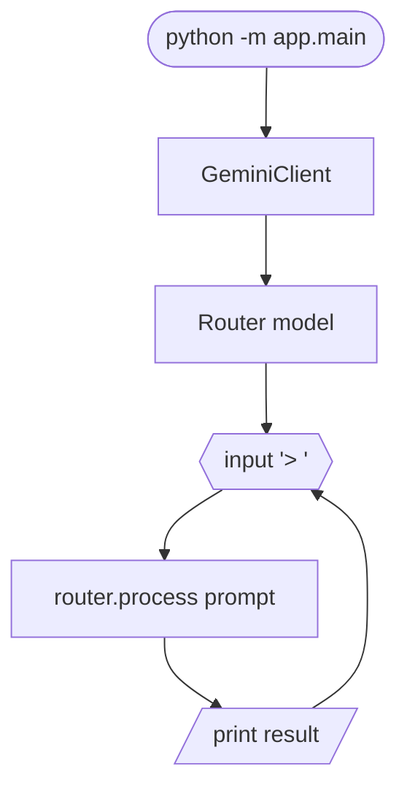

### `app/api.py`: FastAPI service
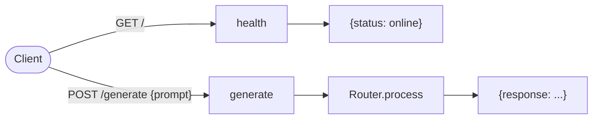

### `orchestration/flowx/router.py`: the 4-agent pipeline
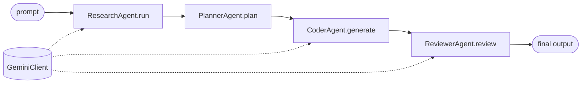

### `orchestration/flowx/workflow.py`: step runner
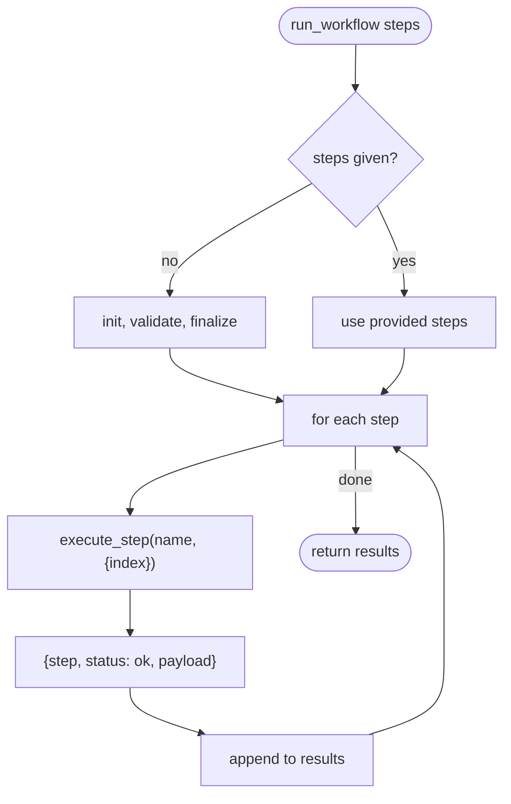

### `orchestration/flowx/task_queue.py`
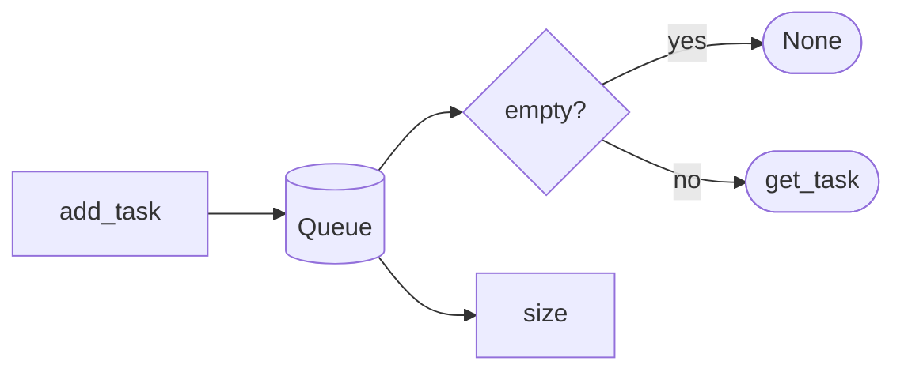

### `core/intelligence_kernel.py`: governed thinking
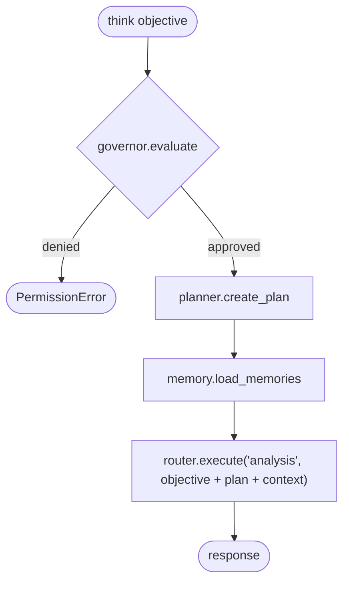

### `core/super_orchestrator.py`
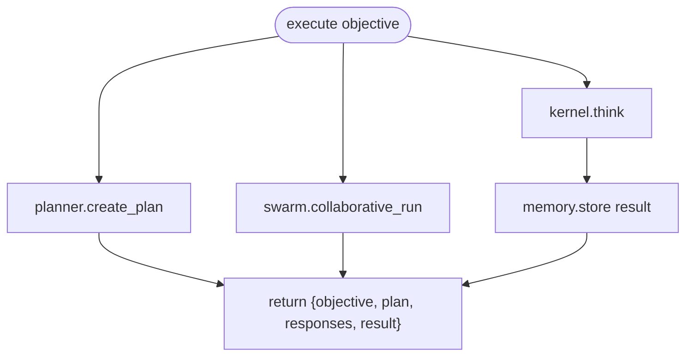

### `core/cognitive_core.py`
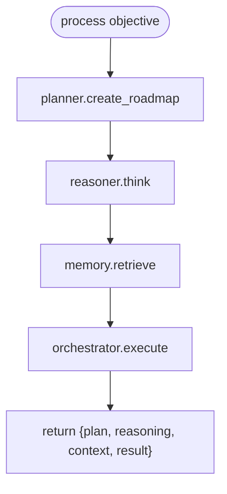

### `routing/adaptive_router.py`
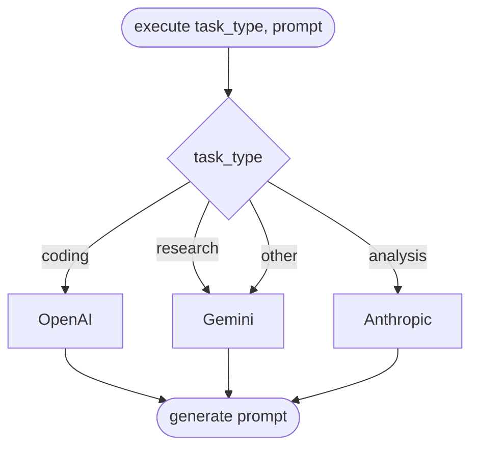

### `memory/vector_store.py` + `rag/rag_retriever.py`
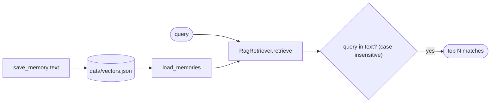

### `recovery/workflow_recovery.py`
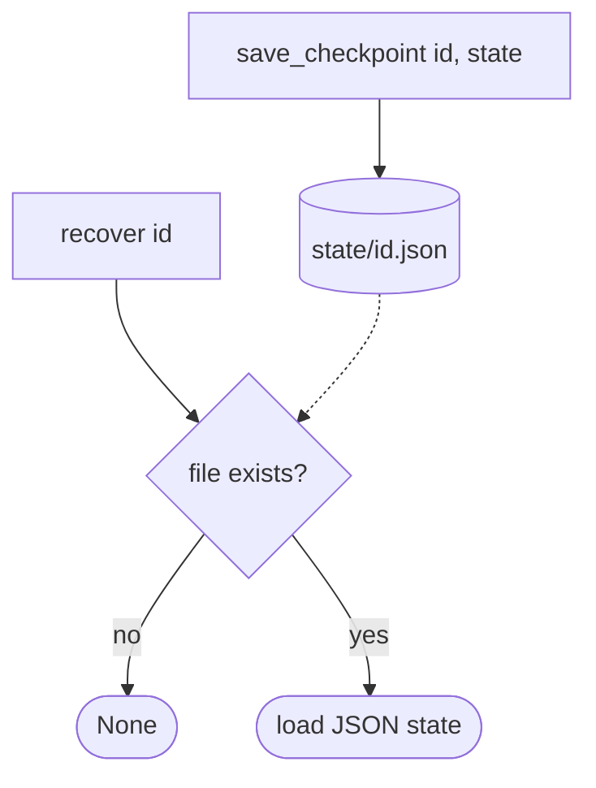

### `security/cognitive_security_layer.py`
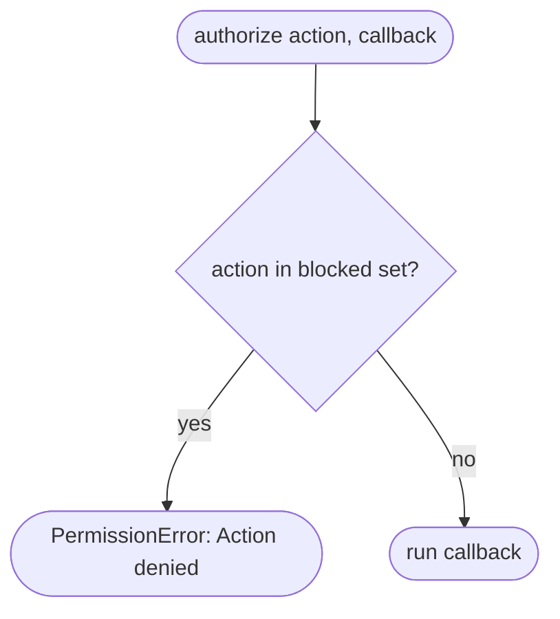

### `.github/workflows/python-ci.yml`
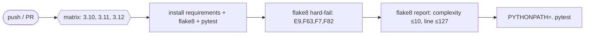

### `.github/workflows/docker-publish.yml`
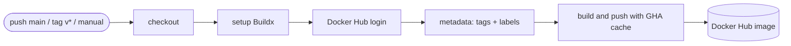

### Package-level flowcharts (the remaining modules)

> These diagrams show how each package's modules relate and can be composed. Only the pipelines above are wired together in code today; the others are building blocks you plug in.

**Agents** (`agents/`)
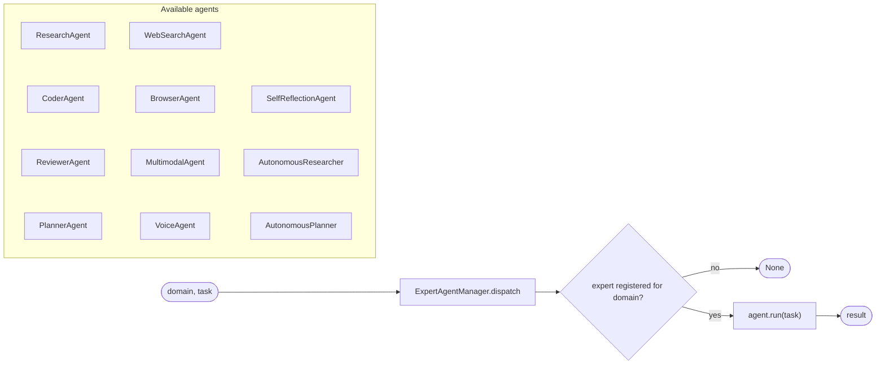

**Planning** (`planning/`)
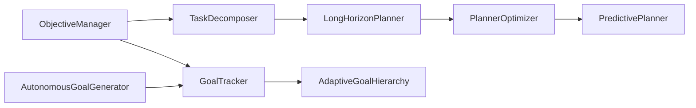

**Reasoning** (`reasoning/`)
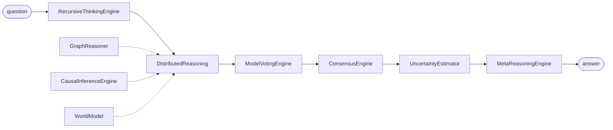

**Memory** (`memory/`)
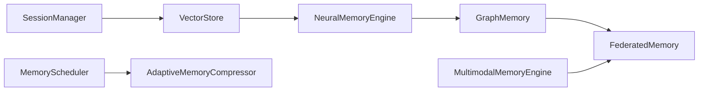

**Models & providers** (`models/`, `providers/`)
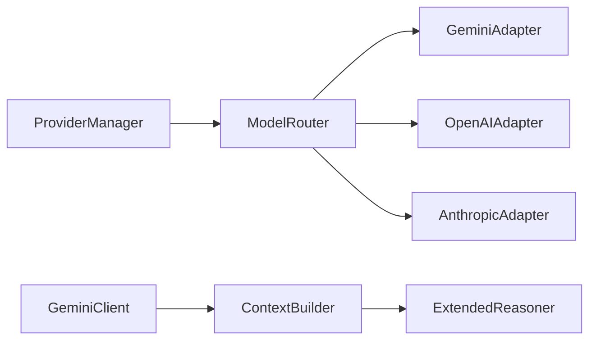

**Governance & security** (`governance/`, `security/`, `trust/`)
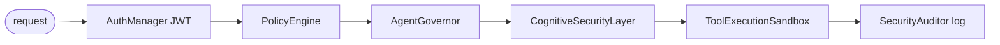

**Observability & cost** (`observability/`, `cost/`, `benchmark/`)
```mermaid
flowchart LR
    RUN([model call]) --> MC[MetricsCollector]
    RUN --> CT[CostTracker]
    RUN --> TB[TokenBudgetManager]
    RUN --> MB[ModelBenchmark]
    MC --> MON[Monitoring]
```

**Integrations & connectors** (`integrations/`, `connectors/`)
```mermaid
flowchart LR
    F([file]) --> DP[DocumentParser]
    DP --> PDF[PDFLoader]
    DP --> DOCX[DocxLoader]
    DP --> XLS[SpreadsheetLoader]
    GD[GoogleDriveClient] --> DS[DriveSync]
    GM[GmailConnector] --> X([context])
    CAL[CalendarConnector] --> X
    GH[GitHubConnector] --> X
```

**Self-improvement loop** (`improvement/`, `maintenance/`, `rewrite/`, `debugging/`, `learning/`)
```mermaid
flowchart LR
    AD[AutonomousDebugger] --> SR[SelfRepairEngine]
    SR --> AR[AutonomousRewriter]
    AR --> SI[SelfImprovementEngine]
    SI --> ML[MetaLearningEngine]
    ML --> AD
```

---

## 😎 Why is this cool? (10 reasons)

1. **One prompt, four specialists.** Research, plan, code, and review agents chain automatically.
2. **Provider-agnostic.** Gemini, OpenAI, and Anthropic adapters sit behind one router.
3. **Task-aware routing.** Coding, research, and analysis each go to a different provider.
4. **Governance built in.** Objectives pass an `AgentGovernor` check before the kernel acts.
5. **Memory and RAG included.** JSON-backed vector store plus a retriever, ready to swap for a real vector DB.
6. **Crash-safe workflows.** Checkpoint and recover any workflow by ID.
7. **Truly modular.** ~50 small packages; swap any one without touching the others.
8. **Production-style CI.** Lint and test on Python 3.10, 3.11, and 3.12 for every push and PR.
9. **Zero-touch delivery.** Every push to `main` and every `v*` tag builds and publishes a Docker image.
10. **Runs anywhere.** CLI, FastAPI service, or container; only an API key is required.

---

## 🧩 What problems does this solve? (10 solutions)

| # | Problem | How SIG addresses it |
|---|---|---|
| 1 | Single-prompt answers are shallow | Multi-stage research → plan → generate → review pipeline |
| 2 | Vendor lock-in | Interchangeable Gemini / OpenAI / Anthropic adapters |
| 3 | Picking the right model per task | `AdaptiveRouter` maps task type to provider |
| 4 | Agents acting without oversight | `AgentGovernor`, `PolicyEngine`, `CognitiveSecurityLayer`, `SecurityAuditor` |
| 5 | LLMs forget context | `VectorStore`, `SessionManager`, `RagRetriever` |
| 6 | Long jobs lost on failure | `WorkflowRecovery` checkpoints |
| 7 | Runaway token spend | `TokenBudgetManager`, `CostTracker`, `MetricsCollector` |
| 8 | Hard-to-extend monoliths | One-class-per-file modular packages, plugin and skill registries |
| 9 | "Works on my machine" | Dockerfile, docker-compose, pinned Python 3.12 image |
| 10 | Unreviewed, untested changes | flake8 + pytest gates in CI on three Python versions |

---

## 🚀 How to install this? (step-by-step)

### Option A: Run from source

```bash
# 1. Clone
git clone https://github.com/kimanicollier44-cmyk/Synthetic-Intelligence-Generator.git
cd Synthetic-Intelligence-Generator

# 2. Create a virtual environment
python -m venv .venv
source .venv/bin/activate          # Windows: .venv\Scripts\activate

# 3. Install dependencies
pip install -r requirements.txt
pip install fastapi uvicorn google-generativeai   # needed to run the app (see note below)

# 4. Set your API key
export GEMINI_API_KEY="your-key-here"             # Windows: set GEMINI_API_KEY=your-key-here

# 5a. Run the interactive CLI
PYTHONPATH=. python -m app.main

# 5b. ...or run the API
PYTHONPATH=. uvicorn app.api:app --host 0.0.0.0 --port 8000
curl -X POST http://localhost:8000/generate \
     -H "Content-Type: application/json" \
     -d '{"prompt": "Explain event-driven architecture"}'
```

> **Note:** `requirements.txt` currently lists only the dev tools (`flake8`, `pytest`). Optional modules import `openai`, `anthropic`, `pyjwt`, `pypdf`, `python-docx`, `pandas`, `requests`, and the Google API client; install whichever modules you use.

### Option B: Docker Hub image

```bash
docker pull credkellar/synthetic-intelligence-generator:latest
docker run -it --rm -e GEMINI_API_KEY="your-key-here" credkellar/synthetic-intelligence-generator:latest
```

The root `Dockerfile` starts the FlowX demo workflow (`python -m orchestration.flowx.workflow`).

### Option C: docker-compose

```bash
export GEMINI_API_KEY="your-key-here"
docker compose -f docker/docker-compose.yml up --build
```

### Run the tests

```bash
PYTHONPATH=. pytest
```

---

## 📋 Requirements

| Requirement | Version / Detail |
|---|---|
| Python | 3.10, 3.11, or 3.12 |
| pip | Latest recommended |
| `flake8` | ≥ 7.0.0 (in `requirements.txt`) |
| `pytest` | ≥ 8.0.0 (in `requirements.txt`) |
| Gemini API key | `GEMINI_API_KEY` env var (for the default pipeline) |
| Docker | Optional (Docker 20+ and Compose v2 for container runs) |
| Optional packages | `fastapi`, `uvicorn`, `google-generativeai`, `openai`, `anthropic`, `pyjwt`, `pypdf`, `python-docx`, `pandas`, `requests`, `google-api-python-client`, `google-auth` |
| Optional secrets | `DOCKERHUB_USERNAME`, `DOCKERHUB_TOKEN` (GitHub repo secrets, for publishing images) |

---

## 🌳 FULL project structure tree

```text
Synthetic-Intelligence-Generator/
├── .github/              # CI/CD workflows
│   └── workflows/
│       ├── docker-publish.yml
│       └── python-ci.yml
├── agents/               # specialist agents
│   ├── agents/
│   │   └── expert_agent_manager.py
│   ├── autonomous_planner.py
│   ├── autonomous_researcher.py
│   ├── browser_agent.py
│   ├── coder_agent.py
│   ├── multimodal_agent.py
│   ├── planner_agent.py
│   ├── research_agent.py
│   ├── reviewer_agent.py
│   ├── self_reflection_agent.py
│   ├── voice_agent.py
│   └── web_search_agent.py
├── analysis/
│   ├── architecture_analyzer.py
│   ├── codebase_graph_engine.py
│   ├── dependency_mapper.py
│   └── emergent_behavior_detector.py
├── app/                  # CLI + FastAPI entrypoints
│   ├── api.py
│   ├── config.py
│   ├── logger.py
│   └── main.py
├── awareness/
│   └── consciousness_monitor.py
├── benchmark/
│   └── model_benchmark.py
├── capabilities/
│   ├── capability_synthesis_engine.py
│   └── universal_skill_registry.py
├── collective/
│   └── collective_intelligence_engine.py
├── connectors/
│   ├── calendar_connector.py
│   ├── github_connector.py
│   └── gmail_connector.py
├── core/                 # orchestrators, kernel, registries
│   ├── agent_registry.py
│   ├── artificial_general_coordination_layer.py
│   ├── capability_discovery.py
│   ├── cognitive_architecture_manager.py
│   ├── cognitive_core.py
│   ├── dynamic_skill_loader.py
│   ├── intelligence_kernel.py
│   ├── meta_orchestrator.py
│   ├── plugin_manager.py
│   ├── super_orchestrator.py
│   ├── tool_registry.py
│   └── universal_orchestrator.py
├── cost/
│   ├── cost_tracker.py
│   └── token_budget_manager.py
├── debugging/
│   └── autonomous_debugger.py
├── docker/               # compose + alt Dockerfile
│   ├── docker-compose.yml
│   └── Dockerfile
├── evolution/
│   ├── intent_evolution_tracker.py
│   └── swarm_evolution_manager.py
├── execution/
│   ├── autonomous_executor.py
│   └── scheduler_engine.py
├── governance/           # policy & governance
│   ├── agent_governor.py
│   ├── policy_engine.py
│   └── security_auditor.py
├── identity/
│   ├── adaptive_persona_manager.py
│   └── self_model_engine.py
├── improvement/
│   └── self_improvement_engine.py
├── integrations/
│   ├── google_drive/
│   │   ├── client.py
│   │   └── sync.py
│   ├── document_parser.py
│   ├── docx_loader.py
│   ├── pdf_loader.py
│   └── spreadsheet_loader.py
├── intelligence/
│   └── strategic_intelligence_layer.py
├── knowledge/
│   └── knowledge_graph_builder.py
├── learning/
│   └── meta_learning_engine.py
├── maintenance/
│   └── self_repair_engine.py
├── marketplace/
│   ├── agent_marketplace.py
│   └── workflow_marketplace.py
├── media/
│   └── image_generator.py
├── memory/               # vector/graph/session memory
│   ├── adaptive_memory_compressor.py
│   ├── federated_memory.py
│   ├── graph_memory.py
│   ├── memory_scheduler.py
│   ├── multimodal_memory_engine.py
│   ├── neural_memory_engine.py
│   ├── session_manager.py
│   └── vector_store.py
├── messaging/
│   ├── distributed_queue.py
│   └── event_bus.py
├── missions/
│   └── autonomous_mission_controller.py
├── models/               # Gemini client + router
│   ├── gemini/
│   │   ├── client.py
│   │   ├── context_builder.py
│   │   └── reasoner.py
│   ├── model_router.py
│   └── provider_manager.py
├── observability/
│   ├── metrics_collector.py
│   └── monitoring.py
├── optimization/
│   └── cognitive_load_balancer.py
├── orchestration/        # FlowX workflow engine
│   ├── flowx/
│   │   ├── router.py
│   │   ├── task_queue.py
│   │   └── workflow.py
│   ├── swarm_coordinator.py
│   ├── workflow_compiler.py
│   ├── workflow_templates.py
│   └── workflow_visualizer.py
├── performance/
│   └── cache_manager.py
├── planning/             # goals & planners
│   ├── adaptive_goal_hierarchy.py
│   ├── autonomous_goal_generator.py
│   ├── goal_tracker.py
│   ├── long_horizon_planner.py
│   ├── objective_manager.py
│   ├── planner_optimizer.py
│   ├── predictive_planner.py
│   └── task_decomposer.py
├── providers/            # OpenAI / Anthropic / Gemini adapters
│   ├── anthropic_adapter.py
│   ├── gemini_adapter.py
│   └── openai_adapter.py
├── rag/                  # embedding + retrieval
│   ├── embedding_service.py
│   ├── knowledge_indexer.py
│   └── rag_retriever.py
├── reasoning/            # reasoning engines
│   ├── reasoning/
│   │   └── scientific_reasoner.py
│   ├── agent_negotiation_engine.py
│   ├── causal_inference_engine.py
│   ├── consensus_engine.py
│   ├── distributed_reasoning.py
│   ├── graph_reasoner.py
│   ├── knowledge_fusion_engine.py
│   ├── long_term_reasoner.py
│   ├── meta_reasoning_engine.py
│   ├── model_voting_engine.py
│   ├── prompt_optimizer.py
│   ├── reasoning_genome.py
│   ├── reasoning_profiler.py
│   ├── recursive_thinking_engine.py
│   ├── temporal_reasoner.py
│   ├── theorem_engine.py
│   ├── uncertainty_estimator.py
│   └── world_model.py
├── recovery/
│   └── workflow_recovery.py
├── research/
│   ├── experiment_runner.py
│   ├── research_citation_manager.py
│   └── research_lab_agent.py
├── rewrite/
│   └── autonomous_rewriter.py
├── routing/
│   ├── adaptive_router.py
│   └── semantic_router.py
├── security/             # auth, sandbox, permissions
│   ├── auth_manager.py
│   ├── cognitive_security_layer.py
│   ├── permissions.py
│   └── tool_execution_sandbox.py
├── simulation/
│   └── simulation_engine.py
├── society/
│   ├── agent_society_manager.py
│   └── autonomous_team_builder.py
├── state/
│   └── state_manager.py
├── tests/                # pytest suite
│   └── test_workflow.py
├── training/
│   ├── agent_training_manager.py
│   ├── reinforcement_loop.py
│   └── synthetic_data_generator.py
├── trust/
│   └── trust_manager.py
├── validation/
│   ├── epistemic_validator.py
│   └── knowledge_validator.py
├── world/
│   └── strategic_world_model.py
├── .dockerignore
├── Dockerfile
├── README.md
└── requirements.txt
```

---

<div align="center">

**Built with 🧠 by [@kimanicollier44-cmyk](https://github.com/kimanicollier44-cmyk)** · ⭐ Star the repo if you find it useful!

</div>
